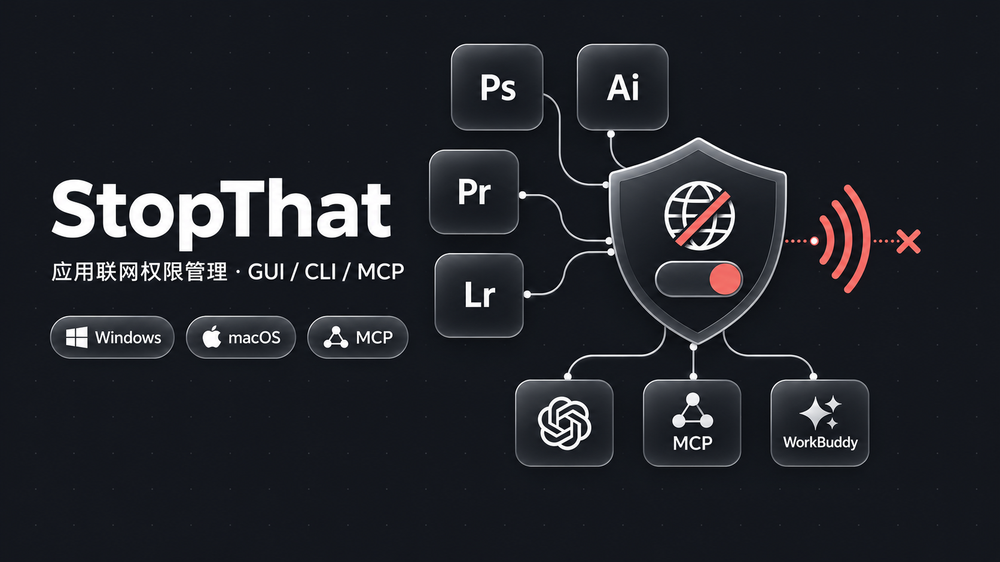
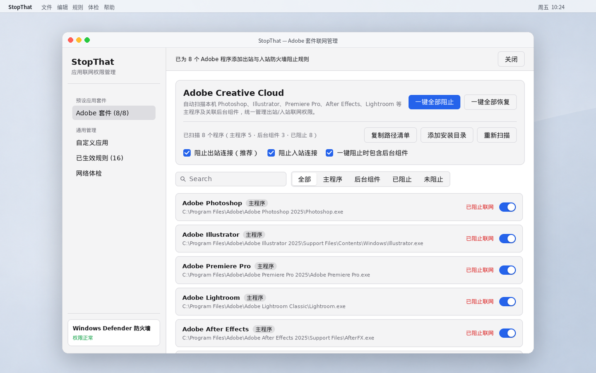
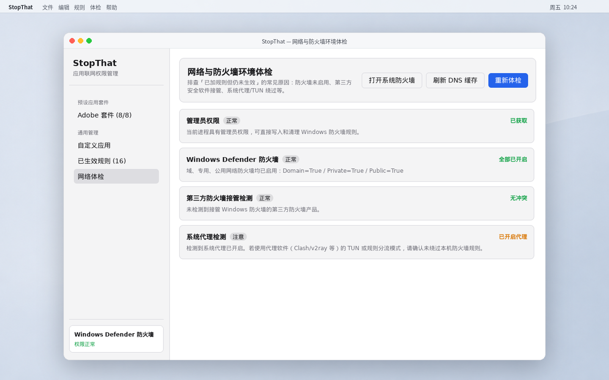
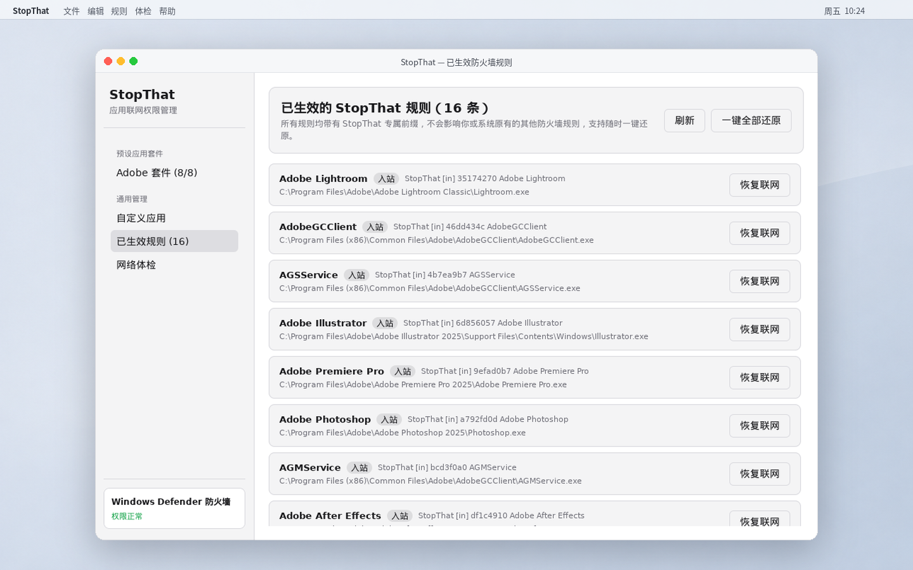

<p align="center">
  
</p>

<h1 align="center">StopThat</h1>

<p align="center">
  基于 <a href="https://mygo.run/zh">MyGo</a> 开发的跨平台（<b>Windows / macOS</b>）原生应用联网权限管理工具<br/>
  内置 <b>图形界面（GUI）+ 命令行（CLI）+ MCP Server</b>，支持 <b>ChatGPT / WorkBuddy / Claude</b> 等 AI Agent 自动安装并全权处理
</p>

<p align="center">
  <a href="https://github.com/hehehai/stopthat/releases/latest">下载最新版 (v0.1.0)</a> ·
  <a href="https://raw.githubusercontent.com/hehehai/stopthat/main/SKILL.md">Agent Skill 文档</a> ·
  <a href="#界面预览">界面预览</a> ·
  <a href="#恢复方式">恢复与还原</a> ·
  <a href="#卸载方式">干净卸载</a>
</p>

---

## 🤖 AI Agent 一键托管（直接复制发送即可）

如果你正在使用 **WorkBuddy、ChatGPT、Claude Code、Codex、OpenClaw** 等具备本机执行能力的 AI Agent，**直接点击下方代码块右上角「复制」发给它**，Agent 会自动下载安装 StopThat、做网络体检、扫描本机应用并按你的确认完成拦截或恢复：

```text
请先阅读这个 Skill 文档：https://raw.githubusercontent.com/hehehai/stopthat/main/SKILL.md
按文档自动检测并安装 StopThat，然后帮我做一次网络与防火墙环境体检，扫描本机 Adobe 套件（若默认目录未找到请询问我的安装目录），把扫描结果列给我确认后再执行阻止联网。
```

**如需一键恢复全部联网（同样直接复制发给 Agent）：**

```text
请使用 StopThat 执行一键还原（stopthat restore --json），清理全部由 StopThat 创建的防火墙规则并确认当前已生效规则数为 0。
```

### 🔌 接入 MCP Server（WorkBuddy / Claude Desktop / Cursor 等）

<details>
<summary><b>展开复制 macOS / Windows 的 MCP 配置（stdio 模式）</b></summary>

**macOS：**
```json
{
  "mcpServers": {
    "stopthat": {
      "command": "/Applications/StopThat.app/Contents/MacOS/StopThat",
      "args": ["mcp"]
    }
  }
}
```

**Windows：**
```json
{
  "mcpServers": {
    "stopthat": {
      "command": "C:\\Users\\<你的用户名>\\AppData\\Local\\StopThat\\stopthat-cli.exe",
      "args": ["mcp"]
    }
  }
}
```

接入后，Agent 可直接调用 7 个标准工具：`stopthat_diagnostics`、`stopthat_scan`、`stopthat_block`、`stopthat_unblock`、`stopthat_list_rules`、`stopthat_restore_all`、`stopthat_flush_dns`。

</details>

---

## 📸 界面预览

### Adobe 套件一键联网管理（主程序 + 后台组件）


### 网络与防火墙环境体检（排查第三方安全软件 / 代理冲突）


### 已生效规则清单与一键还原


---

## ✨ 核心特性

- **内置应用套件预设（首批：Adobe Creative Cloud）**：
  - 自动扫描默认及自定义安装目录，识别 Photoshop、Illustrator、Premiere Pro、After Effects、Lightroom 等**主程序**，以及 `AdobeGCClient`、`AGSService`、`AGMService`、`agcinvokerutility`、`CCXProcess`、`CoreSync` 等**后台关联组件**。
  - 一键全部阻止 / 一键全部恢复 / 单程序独立开关；支持勾选「阻止出站」「阻止入站」「包含后台组件」。
- **通用自定义应用管理**：
  - 支持选择或直接拖入任意 `.exe`、`.app`、Windows `.lnk` 桌面快捷方式或整个安装目录。
  - 一键复制全部扫描到的程序路径清单，方便配合火绒或代理软件使用。
- **安全可逆的规则管理**：
  - 所有规则均带有 `StopThat` 专属前缀，绝不修改或误删系统与用户原有的其他防火墙规则，支持随时**一键全部还原**。
- **网络与防火墙环境体检**：
  - 自动检测管理员权限、系统防火墙开关状态、第三方防火墙接管（火绒 / 360 等）、系统代理状态，并支持一键打开系统防火墙和刷新 DNS 缓存。

---

## 一、下载方式

前往 [GitHub Releases](https://github.com/hehehai/stopthat/releases/latest) 下载对应平台版本：

| 平台 | 文件名 | 说明 |
|---|---|---|
| **macOS（Apple Silicon）** | `stopthat-0.1.0-arm64.dmg` | 已通过 **Developer ID 正式签名 + Apple 官方公证**，双击直接安装运行，同时包含 GUI、CLI 与 MCP |
| **Windows（64 位 图形版）** | `StopThat-windows-amd64.exe` | 免安装单文件图形界面版，内置「一键以管理员身份重启」按钮 |
| **Windows（64 位 CLI / MCP 版）** | `stopthat-cli-windows-amd64.exe` | 控制台版，供终端脚本及 AI Agent（CLI / MCP stdio）调用 |

---

## 二、安装方式

### macOS

1. 下载并双击打开 `stopthat-0.1.0-arm64.dmg`。
2. 将 `StopThat.app` 拖入 **`应用程序（/Applications）`** 文件夹。
3. 直接双击启动即可（已通过 Apple 公证，无需绕过 Gatekeeper）。
4. **（可选）启用终端 `stopthat` 命令**：
   ```bash
   mkdir -p ~/.local/bin
   ln -sf /Applications/StopThat.app/Contents/MacOS/StopThat ~/.local/bin/stopthat
   ```

### Windows

1. 下载 `StopThat-windows-amd64.exe`，放到任意固定目录（例如 `C:\Tools\StopThat\` 或 `%LOCALAPPDATA%\StopThat\`）。
2. 双击运行：如果顶部提示需要管理员权限，直接点击横幅上的 **「以管理员身份重启」** 即可弹出 UAC 授权（或右键选择「以管理员身份运行」）。
3. **（可选）如需给终端或 AI Agent 使用 CLI / MCP**：同时下载 `stopthat-cli-windows-amd64.exe` 到同目录即可。

---

## 三、使用方式

### 1. 图形界面（GUI）

启动 StopThat 后，左侧栏分为 4 个功能页：

- **Adobe 套件**：打开即自动扫描默认目录；若安装在 D 盘等自定义目录，点击 **「添加安装目录」** 或直接把文件夹拖入窗口，点击 **「一键全部阻止」** 即可批量写入规则。
- **自定义应用**：点击 **「选择程序」** / **「选择目录」**，或直接把桌面快捷方式（`.lnk`）、`.exe` / `.app`、安装目录拖入窗口即可管理。
- **已生效规则**：集中查看所有由 StopThat 创建的防火墙规则，支持按条恢复或一键全部还原。
- **网络体检**：遇到规则不生效时先点 **「重新体检」**，可快速排查管理员权限、系统防火墙开关、火绒/360 接管、系统代理状态，并支持一键打开系统防火墙或刷新 DNS。

> **平台能力说明**：
> - **Windows**：通过 Windows Defender 防火墙批量管理**出站 + 入站**规则，完整覆盖阻止联网需求。
> - **macOS**：系统自带 `socketfilterfw` 防火墙仅拦截**入站**连接；如需 macOS 应用级**出站**拦截，可配合免费开源的 [LuLu](https://objective-see.org/products/lulu.html) 使用，后续计划通过 Apple Network Extension 原生支持（见 [docs/macos-outbound.md](docs/macos-outbound.md)）。

### 2. 命令行（CLI）

```bash
# 查看环境体检（JSON 输出）
stopthat doctor --json

# 扫描 Adobe 套件（可附加自定义目录）
stopthat scan --preset adobe --dir "D:\Adobe" --json

# 一键阻止 Adobe 套件全部主程序与后台组件
stopthat block --preset adobe --json

# 阻止自定义程序或目录
stopthat block --path "C:\Path\To\MyApp" --json

# 查看当前所有 StopThat 规则
stopthat rules --json

# 刷新 DNS 缓存
stopthat flush-dns --json
```

---

## 四、恢复方式

随时可以将被阻止的程序恢复正常联网，提供 3 种粒度：

1. **恢复单个程序**：在界面列表里关闭该程序右侧的开关，或在 **「已生效规则」** 页面点击对应规则的 **「恢复联网」**。
2. **恢复整个套件**：在 **Adobe 套件** 页面点击 **「一键全部恢复」**，或执行：
   ```bash
   stopthat unblock --preset adobe
   ```
3. **一键全部还原（彻底清除所有 StopThat 规则）**：在 **「已生效规则」** 页面点击 **「一键全部还原」**，或执行：
   ```bash
   stopthat restore
   ```
   > 该操作只会删除带有 `StopThat` 前缀的规则，绝不会影响系统或你手动配置的其他防火墙规则。

---

## 五、卸载方式

为了不残留任何防火墙规则，请按以下顺序卸载：

### 1. 先一键还原全部规则
打开 StopThat → 进入 **「已生效规则」** → 点击 **「一键全部还原」**（或终端运行 `stopthat restore`）。

### 2. 删除程序与配置文件

- **macOS**：
  ```bash
  rm -rf /Applications/StopThat.app
  rm -rf "$HOME/Library/Application Support/StopThat"
  rm -f "$HOME/.local/bin/stopthat"
  ```
- **Windows（PowerShell）**：
  ```powershell
  # 删除你存放 StopThat.exe / stopthat-cli.exe 的目录，以及配置文件目录：
  Remove-Item -Recurse -Force "$env:APPDATA\StopThat" -ErrorAction SilentlyContinue
  Remove-Item -Recurse -Force "$env:LOCALAPPDATA\StopThat" -ErrorAction SilentlyContinue
  ```

---

## 本地开发与构建

```bash
# 运行全部单元测试与 MyGo 无头 UI 测试
CGO_ENABLED=0 go test -v ./...

# Windows 交叉编译（GUI 版 + CLI/MCP 版）
CGO_ENABLED=0 GOOS=windows GOARCH=amd64 go build -trimpath -ldflags "-s -w -H=windowsgui" -o build/StopThat-windows-amd64.exe .
CGO_ENABLED=0 GOOS=windows GOARCH=amd64 go build -trimpath -ldflags "-s -w" -o build/stopthat-cli-windows-amd64.exe .

# macOS 正式签名 + Apple 公证打包（在 Apple Silicon Mac 上运行）
./scripts/release-mac.sh
```

## License

[MIT](./LICENSE)
