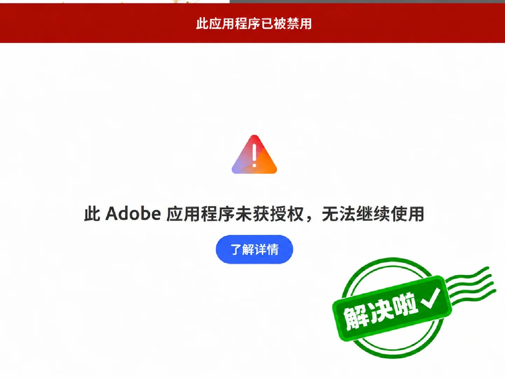
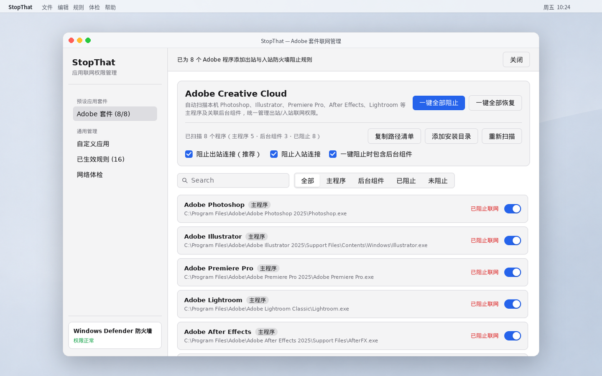
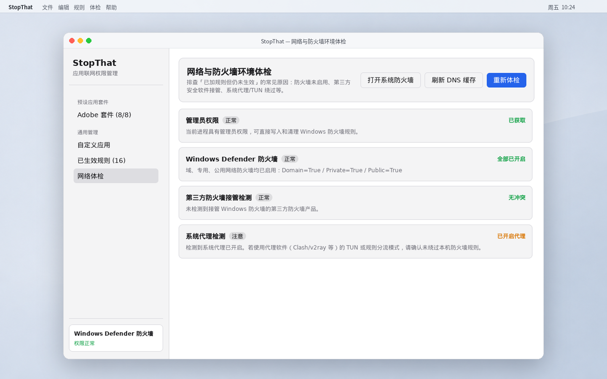
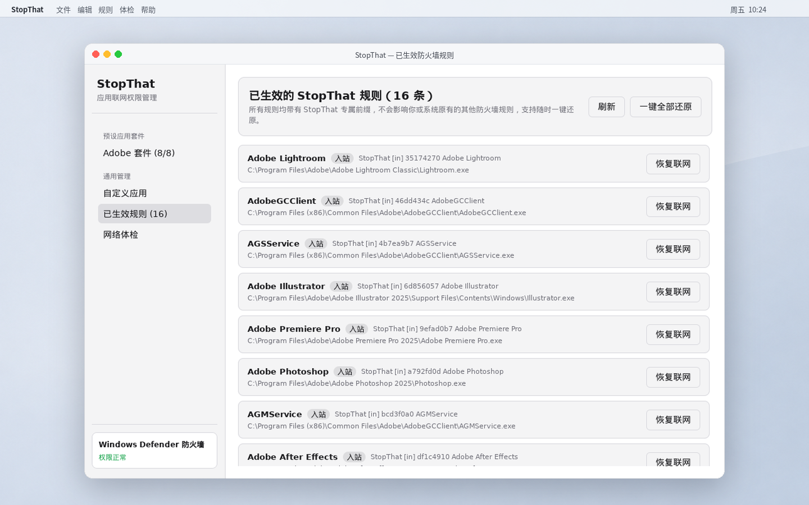

# Adobe 联网报错与禁用弹窗完全处理指南（StopThat 专版）

近期（2026 年 11 月底），大量中国区设计师与用户在打开 **Photoshop、Illustrator、Premiere Pro、After Effects、Lightroom** 等 Adobe 系列软件时，遇到了如下禁用提示弹窗：

<p align="center">
  
</p>

本文完整说明该问题的成因、为什么手动处理容易遗漏，以及如何通过 **[StopThat](https://github.com/hehehai/stopthat)** 在不影响电脑正常上网的前提下，一键完成排查、拦截与随时恢复。

---

## 一、为什么会出现这个弹窗？

当 Adobe 主程序或它在后台运行的相关服务尝试连接外部服务器进行联网校验时，一旦触发校验限制，就会弹出禁用提示并阻止继续使用。

解决这个问题的核心思路非常明确：**对 Adobe 套件实施「网络隔离」——同时阻止主程序和后台关联组件的联网连接**，而不是拔网线或关闭 Wi-Fi（那会导致整台电脑断网）。

---

## 二、为什么手动配置容易失败或反复弹窗？

很多用户尝试手动在系统防火墙里配置规则，但经常遇到「设置完没几天又弹窗」或「操作太繁琐」，常见原因有 4 个：

1. **手动找路径、删引号极易出错**：从桌面快捷方式复制「目标」路径时，路径首尾默认带有英文双引号（`"`），粘贴进防火墙如果不手动删掉就会导致规则无效。
2. **只拦截主程序远远不够**：只把 `Photoshop.exe`、`Illustrator.exe` 设为阻止联网后，Adobe 在后台依然运行着多个独立进程，包括：
   - `AdobeGCClient`
   - `AGSService`
   - `AGMService`
   - `agcinvokerutility`
   - `CCXProcess` / `CoreSync` / `Creative Cloud` 等关联组件
   只要漏掉其中任意一个后台组件，依然可能触发弹窗。
3. **需要同时覆盖「出站 + 入站」与全部网络类型**：仅配出站规则在部分环境下不够稳妥，通常需要同时添加「出站规则」和「入站规则」，并同时勾选「域、专用、公用」全部网络配置文件。
4. **规则分散、后续难还原**：手动逐个软件、逐个后台组件建完往往有二三十条零散规则，日后想临时恢复联网或彻底清理非常麻烦。

---

## 三、使用 StopThat 一键解决（推荐）

**[StopThat](https://github.com/hehehai/stopthat/releases/latest)** 是专为应用联网权限管理打造的跨平台原生工具（支持 Windows 与 macOS），内置 **Adobe Creative Cloud** 专属扫描预设，把上面所有繁琐步骤压缩成一次点击。

### 方式 A：图形界面 3 步搞定

1. **下载并启动 StopThat**：
   - 前往 [GitHub Releases](https://github.com/hehehai/stopthat/releases/latest) 下载对应版本（Windows 为免安装单文件 `StopThat-windows-amd64.exe`，macOS 为已签名公证的 `stopthat-0.1.0-arm64.dmg`）。
   - Windows 上若顶部提示需要管理员权限，直接点击横幅上的 **「以管理员身份重启」** 即可自动弹出 UAC 授权。
2. **自动扫描全部 Adobe 主程序与后台组件**：
   - 打开 **「Adobe 套件」** 页面，StopThat 会自动扫描系统默认目录（`Program Files\Adobe`、`Common Files\Adobe` 等），自动归类「主程序」与「后台组件」。
   - 如果你的 Adobe 安装在 D 盘等自定义目录，点击 **「添加安装目录」**，或**直接把安装文件夹 / 桌面 `.lnk` 快捷方式拖进 StopThat 窗口**即可自动识别。
3. **一键全部阻止**：
   - 保持默认勾选：**「阻止出站连接（推荐）」「阻止入站连接」「一键阻止时包含后台组件」**。
   - 点击右上角 **「一键全部阻止」**，StopThat 会在 1~2 秒内为全部主程序与后台组件批量写入系统防火墙规则，期间电脑其他软件完全正常上网。



### 方式 B：命令行（CLI）一键处理

习惯终端或批量部署的用户，可以直接使用 StopThat CLI：

```bash
# 1. 先做网络与防火墙体检
stopthat doctor

# 2. 扫描本机 Adobe 主程序与后台组件（自定义目录可加 --dir）
stopthat scan --preset adobe --dir "D:\Adobe"

# 3. 一键批量阻止全部主程序 + 后台组件的出站与入站连接
stopthat block --preset adobe --dir "D:\Adobe"
```

### 方式 C：交给 AI Agent 全权代办

如果你正在使用 **ChatGPT、WorkBuddy、Claude Code** 等具备本机执行能力的 AI Agent，只需复制下面这段话发给它，Agent 会自动安装 StopThat 并帮你走完体检、扫描和拦截全流程：

```text
请先阅读这个 Skill 文档：https://raw.githubusercontent.com/hehehai/stopthat/main/SKILL.md
按文档自动检测并安装 StopThat，先帮我运行网络体检，再扫描本机所有 Adobe 主程序和后台组件，确认后用 StopThat 一键阻止它们的出站和入站联网。
```

---

## 四、如果设置后依然弹窗，或出现错误 206 / 12032 怎么办？

如果按上述步骤阻止后仍有异常，或出现 `206`、`12032` 等网络相关错误，通常是系统防火墙状态、系统代理或之前手动改过系统网络配置导致的。按以下顺序排查即可：

### 1. 在 StopThat 中运行「网络体检」

切换到左侧 **「网络体检」** 页面，点击 **「重新体检」**：



重点检查以下 3 项：
- **管理员权限**：确认已显示「已获取」；
- **系统防火墙状态**：确认域、专用、公用网络防火墙均为「开启」状态（如果系统防火墙本身被关闭，防火墙规则将不会生效；可点击 **「打开系统防火墙」** 直接检查）；
- **系统代理状态**：如果开启了系统代理，部分流量可能经由代理转发，请确认代理配置未绕过本机网络策略。

### 2. 一键刷新 DNS 缓存

在 **「网络体检」** 页面直接点击 **「刷新 DNS 缓存」**（或执行 `stopthat flush-dns`），清除旧的域名解析缓存。

### 3. 检查历史残留的 `hosts` 与网络栈重置

如果你之前手动修改过系统 `hosts` 文件，残留的失效条目可能会引起 `206` / `12032` 等异常：
- 打开系统 `hosts` 文件（Windows 位于 `C:\Windows\System32\drivers\etc\hosts`，macOS 位于 `/etc/hosts`），清理掉之前手动添加的多余屏蔽条目；
- Windows 用户可在管理员命令提示符中执行 `netsh winsock reset` 后重启电脑，再通过 StopThat 重新一键阻止即可。

---

## 五、随时恢复联网与安全还原

StopThat 创建的每一条防火墙规则都带有专属的 **`StopThat`** 命名前缀，绝不触碰系统或你原有的其他规则。



需要恢复联网时，随时可以按 3 种方式还原：
- **恢复单个软件**：在列表里关闭对应软件的开关，或在「已生效规则」里点击 **「恢复联网」**；
- **恢复整个 Adobe 套件**：在 Adobe 套件页点击 **「一键全部恢复」**（或运行 `stopthat unblock --preset adobe`）；
- **一键清空所有 StopThat 规则**：在「已生效规则」页点击 **「一键全部还原」**（或运行 `stopthat restore`），秒级恢复至安装前的初始状态。

---

## 核心要点速览

| 痛点 | 传统手动操作 | 使用 StopThat |
|---|---|---|
| 找路径与删引号 | 逐个右键属性复制、手动删双引号 | 自动扫描全部目录，也支持直接拖入 `.lnk` / 文件夹 |
| 后台组件漏网 | 容易漏掉 `AGSService` / `AGMService` / `AdobeGCClient` 等 | 预设自动识别主程序 + 全部关联后台组件 |
| 出站 + 入站双配 | 每个程序都要手动建 2 条规则，耗时十几分钟 | 1 键批量写入，1~2 秒完成 |
| 排错与还原 | 几十条规则混在系统列表里难查难删 | 内置网络体检 + 专属规则前缀，随时一键彻底还原 |
